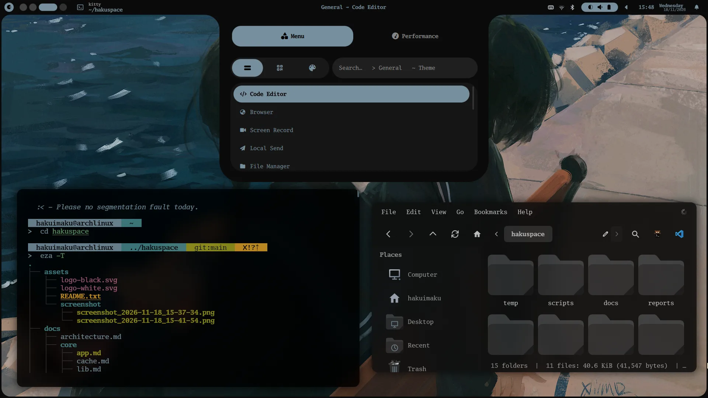
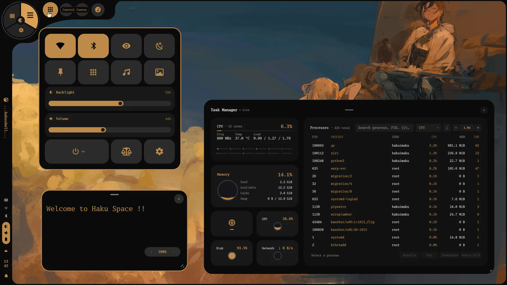
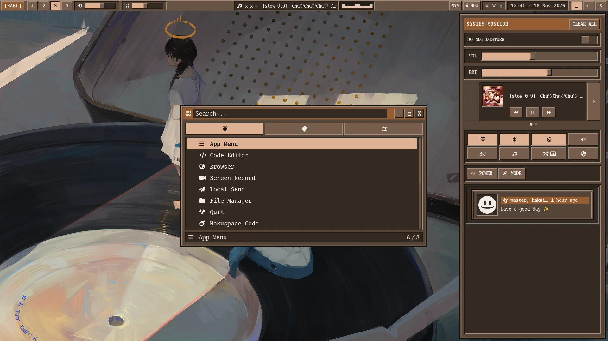
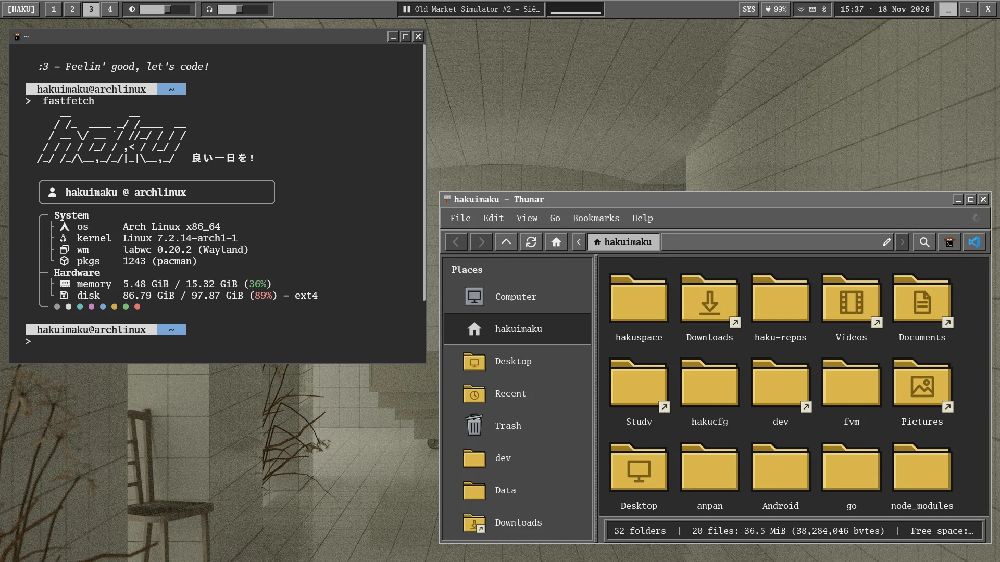

<div align="center">

# Haku Space
Wayland dotfiles and desktop shell for Hyprland / Niri / MangoWM / Labwc

**Classic** (Waybar / Rofi / SwayNC) + **Hikai** (Quickshell-native desktop experience)

*Haku (ハク) is the very highest Value, the manifestation of a wish. It means "the shape of a soul," "that which is irreplaceable."*
    <div align="right">
        <i>- Made in Abyss -</i>
    </div>

</div>

<p align="center">
    <a href="https://github.com/hyprwm/Hyprland"></a>&nbsp;
    <a href="https://github.com/YaLTeR/niri"></a>&nbsp;
    <a href="https://github.com/mangowm/mango"></a>&nbsp;
    <a href="https://github.com/labwc/labwc"></a>&nbsp;
    <br />
    <a href="https://github.com/hakuimaku/hakuspace/commits/main"></a>&nbsp;
    <a href="https://github.com/hakuimaku/hakuspace/stargazers"></a>&nbsp;
    <a href="https://github.com/hakuimaku/hakuspace"></a>
</p>

|  |  |
|--|--|
|  |  |

<div align="center">

[Installation](#installation-guide) · [Shell Modes](#shell-modes) · [Update & Maintenance](#update--maintenance) · [Keybinding](#keybinding) · [Docs](#documentation) · [Troubleshooting](#troubleshooting)

[](https://discord.gg/Juuun8sXsN) [](https://www.tiktok.com/@hakuimaku2372)

</div>

- **Dual Shell Modes:** Switch anytime between **Classic** (`Waybar` / `Rofi` / `SwayNC` retro 9-scheme UI) and **Hikai** (`Quickshell` native shell).
- **Multi-WM Support:** Hyprland, Niri, MangoWM, and Labwc share the same scripts, state, theming, and `~/hakucfg` customization layer.
- **Arch Linux Focused:** Actively developed and tested on **Arch Linux** (legacy [Fedora](docs/fedora_guide.md) and [NixOS](docs/nixos.md) guides are kept for reference only).
- **Safe & Modular:** Deep Symlink or Copy deployment, automatic backups before changes, and read-only diagnostics via `./doctor.sh`.

---

## Shell Modes

- **Hikai (Quickshell):** Integrated bar (`topbar` / `leftbar`), taskbar/dock, HakuMenu, dashboard, notifications, wallpaper browser/video renderer, image editor, and lock screen.
- **Classic (Waybar / Rofi / SwayNC):** Retro window-titlebar top bar, unified Rofi menus, `SYSTEM MONITOR` SwayNC, cassette `Hyprlock`, and a 9-scheme palette synced from your wallpaper (plus manual `colorful`).

Switch or check the active shell anytime:

```bash
~/.local/bin/backend_switcher.sh            # Open interactive selector
~/.local/bin/haku_backend.sh set hikai      # Switch to Hikai
~/.local/bin/haku_backend.sh set classic    # Switch to Classic
```

<details>
<summary>Core stack & package lists</summary>

Package manifests: [pkg-core](src/packages/pkg-core.txt) · [pkg-service](src/packages/pkg-service.txt) · [pkg-optional](src/packages/pkg-optional.txt) · [pkg-hyprland](src/packages/pkg-hyprland.txt) · [pkg-niri](src/packages/pkg-niri.txt) · [pkg-mango](src/packages/pkg-mango.txt) · [pkg-labwc](src/packages/pkg-labwc.txt)

- **Shell / Bar / Launcher:** [Quickshell](https://quickshell.org/), [Waybar](https://github.com/alexays/waybar), [Rofi](https://github.com/davatorium/rofi), [SwayNC](https://github.com/ErikReider/SwayNotificationCenter)
- **Terminal & Prompt:** [Kitty](https://github.com/kovidgoyal/kitty), [Fish](https://fishshell.com/) + [Starship](https://starship.rs/)
- **Files, Media & Lock:** [Thunar](https://docs.xfce.org/xfce/thunar/start), [Awww](https://codeberg.org/LGFae/awww), `mpvpaper`, [Hyprlock](https://github.com/hyprwm/hyprlock), [Hypridle](https://github.com/hyprwm/Hypridle), [wl-screenrec](https://github.com/russelltg/wl-screenrec), [Ly](https://codeberg.org/fairyglade/ly#systemd)

</details>

---

## Installation Guide

> [!note]
> Requires an existing **Arch Linux** (or derivative) base with network, audio, Bluetooth, and GPU drivers already working.

```bash
# Clone latest git, run installer, and deploy to your home directory
git clone https://github.com/hakuimaku/hakuspace.git ~/hakuspace
cd ~/hakuspace
chmod +x install.sh
./install.sh
```

Restart and log in to **Hyprland**, **Niri**, **MangoWM**, or **Labwc**.

- Want manual step-by-step control or **Quickshell-only (Hikai)** on your own WM config? See [Manual / Modular Workflow](docs/management.md#5-manual--modular-workflow).
- Install or inspect the visual themes (`Haku-Dark` / `Hikaide` / `Hikaide-Symbols` + `Cassettk` / `Cassetton` / `Cassettsor`) independently anytime with `./scripts/setup.sh setup` and `./scripts/setup.sh status` (see [Visual Setup](docs/visual-setup.md)).
- Optional post-install extras: `yay -S waybar-cava` (Classic Waybar visualizer) and `xhost +si:localuser:root` (if root X11 GUI apps like `GParted` need display access).

---

## Update & Maintenance

```bash
cd ~/hakuspace
./update.sh                  # Pull, deploy, migrate, sync state, and run diagnostics
./doctor.sh                  # Read-only health check for symlinks, state, and hakucfg
./rollback.sh                # Restore a previous ~/.backup/Backup_* snapshot
./unlink.sh --all <wm>       # Safely remove managed symlinks (hyprland|niri|mango|labwc)
```

Personal overrides live in `~/hakucfg` and are never silently overwritten. For full details on deployment modes, migrations, visual themes, and safe uninstallation, see [Management & Deployment](docs/management.md).

---

## Keybinding

Common hotkeys across compositors (full configs: [Hyprland](src/home/.config/hypr/config/keybinding.lua) · [Niri](src/home/.config/niri/keybinds.kdl) · [MangoWM](src/home/.config/mango/bind.conf) · [Labwc](src/home/.config/labwc/rc.xml#L267)):

| Bind | Function | Bind | Function |
|---|---|---|---|
| `SUPER + Space` | App Launcher | `SUPER + Q` | Kitty Terminal |
| `SUPER + C` | Close Window | `SUPER + E` / `B` | File Manager / Browser |
| `SUPER + TAB` | Haku Menu | `SUPER + N` | Notification Center |
| `SUPER + V` / `SHIFT + V` | Clipboard / Wipe | `SUPER + /` | Emoji Menu |
| `SUPER + P` / `SHIFT + P` | Screenshot / Fullscreen | `SUPER + F11` | Screen Recorder |
| `SUPER + Y` / `SHIFT + Y` | Wallpaper / Theme | `SUPER + T` | Cava Underbar |
| `SUPER + Z` / `SHIFT + Z` | Taskbar / Bar Mode (Hikai) | `SUPER + CTRL + Z` | Toggle Waybar (Classic) |
| `SUPER + SHIFT + E` / `Q` | Exit Session / Power Menu | `SUPER + 1..9` | Switch Workspace (`SHIFT` to move) |

<details>
<summary>Window-manager specific binds (Hyprland / Niri / MangoWM / Labwc)</summary>

| WM | Bind | Function |
|---|---|---|
| **Hyprland** | `SUPER + D / SHIFT + D` | Scroller Column Resize (`+0.1` / `-0.1`) |
| | `SUPER + L` / `X` / `F1` | Cycle Layout / Scratchpad / No-gap Mode |
| | `SUPER + U / = / -` | Cursor Zoom |
| **Niri** | `SUPER + G` / `M` / `ALT + F` | Overview / Maximize to Edges |
| | `SUPER + D / SHIFT + D` / `Mod + Shift + /` | Column Width (`±10%`) / Hotkey Overlay |
| **MangoWM** | `SUPER + G` / `ALT + TAB` / `D` | Overview / Proportion Preset |
| | `SUPER + ALT + R` / `CTRL + ALT + Delete` | Reload Config / Quit MangoWM |
| **Labwc** | `SUPER + M` / `S` / `D` / `F` | Maximize / Minimize / Show Desktop / Fullscreen |
| | `ALT + \`` / `ALT + Tab` / `ALT + WASD` / `SUPER + Arrows` | Client Menu / Cycle / Resize / Snap |

</details>

---

## Documentation

Full technical and developer documentation lives in `docs/` (Vietnamese translations in `docs/vietnamese/`):

- **Start here:** [Architecture Overview](docs/architecture.md) · [Management & Deployment](docs/management.md) · [Visual Setup](docs/visual-setup.md)
- **Hikai (Quickshell):** [Hikai Architecture](docs/hikai.md)
- **Core internals (`src/core/`):** [Core Structure](src/core/README.md) · [Libraries](docs/core/lib.md) · [Theming](docs/core/theme.md) · [State](docs/core/state.md) · [Cache](docs/core/cache.md) · [Menu](docs/core/menu.md) · [System](docs/core/sys.md) · [Utilities](docs/core/util.md) · [Mini-Apps](docs/core/app.md)
- **Legacy references:** [Fedora Guide](docs/fedora_guide.md) · [NixOS Integration](docs/nixos.md)

---

## Troubleshooting

- **Hikai fails to start:** Check `~/.local/bin/haku_backend.sh --verify` or recover to Classic with `~/.local/bin/haku_backend.sh --recover`. Runtime logs are under `${XDG_RUNTIME_DIR}/hakuspace/`; install/update transcripts are under `log/`.
- **Broken links or config issues:** Run `./doctor.sh` (read-only diagnostics) or `./rollback.sh` to restore a backup.
- **Need help?** Open a GitHub issue or join [Discord](https://discord.gg/Juuun8sXsN).

---

## Contributing, Credits & License

- Personal dotfiles setup — PRs and forks are welcome.
- **Maintainer:** [hakuimaku](https://github.com/hakuimaku) · **Wallpapers:** [hakuspace-archive](https://github.com/hakuimaku/hakuspace-archive)
- **Community attribution:** [tspillow](https://github.com/tspillow) contributed the former `tokyo` Waybar style (commits `5267a4df`, `4ea823c2`), removed when Classic unified around the 8-scheme layout; last retained at commit [`05957567`](https://github.com/hakuimaku/hakuspace/tree/059575675bd2e5a064d18e6697d9b14155a64937/src/home/.config/waybar/tokyo).
- **License:** MIT
